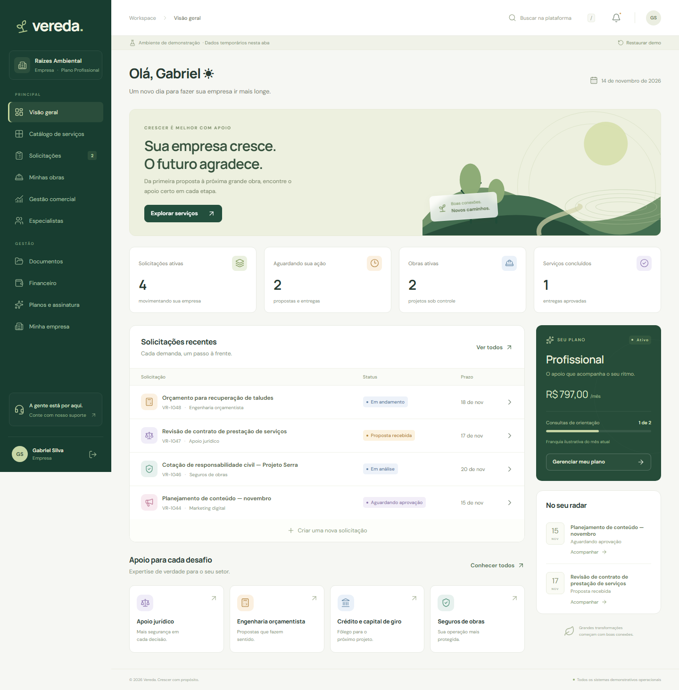

# Vereda · Plataforma de serviços ambientais

Primeira versão demonstrativa do escopo enviado no compartilhamento e no PDF. Interface em português, feita em **React + JavaScript + Vite**, pronta para hospedagem estática na Vercel. “Vereda” é a marca provisória utilizada na apresentação.



## Executar

Requisito: Node.js 22.12 ou superior. Recomendado: Node.js 24 LTS.

```bash
npm install
npm run dev
```

Abra **http://127.0.0.1:5173**. Não é necessário configurar banco de dados, chaves, variáveis de ambiente ou serviços externos.

## Acessos de demonstração

Os três perfis podem ser selecionados na tela de entrada, com as credenciais já preenchidas.

| Perfil        | E-mail                | Senha   |
| ------------- | --------------------- | ------- |
| Empresa       | cliente@vereda.demo   | demo123 |
| Prestador     | prestador@vereda.demo | demo123 |
| Administrador | admin@vereda.demo     | demo123 |

O botão de saída no rodapé do menu permite trocar de perfil sem apagar as alterações da sessão. O prestador de exemplo é o engenheiro Rafael Mendes. O administrador consegue operar as demandas das sete categorias.

## O que está implementado

### Portal da empresa

- Dashboard com indicadores derivados dos registros, solicitações recentes, atalhos e resumo do plano.
- Catálogo com as sete especialidades: jurídico, engenharia orçamentista, crédito, seguros, marketing, gestão comercial e gestão de obras.
- Detalhamento do serviço, entregáveis, condições, prazo e valores de referência.
- Nova solicitação com campos específicos por categoria, prioridade, prazo e anexo.
- Busca, filtros, paginação, visualização em lista/cartões e exportação de solicitações em CSV.
- Proposta em PDF, aceite nominal simulado, contratação e acompanhamento por etapas.
- Conversa local com o especialista, envio e download de documentos.
- Aprovação de entrega, solicitação de ajustes e avaliação de uma a cinco estrelas.
- Planos Essencial (R$ 297), Profissional (R$ 797) e Empresarial (R$ 1.997), troca e cancelamento.
- Desconto do plano aplicado automaticamente nas novas propostas de serviços elegíveis.
- Checkout simulado por Pix, cartão e boleto; faturas, comprovantes demonstrativos e extrato CSV.
- Documentos com busca, filtro, visualização de exemplos/imagens, upload, download e exclusão.
- Cadastro e edição de obras, orçamento, custos, avanço físico e diário de obra.
- Funil comercial com oportunidades, movimentação por seletor de etapa, edição, exclusão e exportação.
- Edição do cadastro empresarial, diretório de especialistas, notificações e suporte.

### Painel do prestador

- Dashboard com demandas, prazos e remuneração prevista.
- Carteira filtrada pelo especialista de demonstração.
- Envio de proposta, início de execução e registro da entrega.
- Conversas e documentos associados à carteira.
- Remuneração ilustrativa com participação de 80% e exportação do extrato.

### Painel administrativo

- Visão geral da operação, empresas, especialistas e solicitações.
- Cadastro/edição de empresas e alteração administrativa de plano/status, sem criação de novas credenciais.
- Edição dos perfis no diretório de especialistas.
- Operação de solicitações das sete categorias, propostas, documentos, entregas e cobranças.
- Catálogo dos planos e indicadores: volume pago, MRR dos cadastros ativos, conclusão, satisfação, evolução mensal e demanda por especialidade.
- Resposta aos atendimentos de suporte.

## Roteiro sugerido para apresentar ao cliente

1. Entre como **Empresa** e mostre o dashboard, o catálogo e os detalhes de um serviço.
2. Solicite um serviço de **engenharia**, preenchendo o contexto e o prazo.
3. Saia e entre como **Administrador**, abra a nova solicitação e envie uma proposta com escopo, preço e prazo. O desconto do plano será calculado quando aplicável.
4. Volte ao perfil **Empresa**, aprove a proposta com o aceite nominal e confirme um pagamento simulado.
5. Entre como **Prestador**, abra a mesma solicitação, inicie a execução, anexe um material e registre a entrega. Para outras especialidades, use o Administrador.
6. Volte como **Empresa**, confira a entrega e aprove com uma avaliação. Também é possível pedir ajustes.
7. Mostre financeiro, documentos, planos, obras e CRM. No Administrador, mostre empresas, suporte e indicadores.
8. Use **Restaurar demo** para retornar aos exemplos iniciais antes de uma nova apresentação.

Para uma apresentação rápida, já existem uma proposta jurídica aguardando aprovação, uma entrega de marketing para avaliar e uma solicitação de engenharia em execução.

## Dados temporários e limites desta fase

- A aplicação utiliza `sessionStorage`, com estado React em memória. As alterações sobrevivem a recarregamentos e à troca de perfil **na mesma aba**. Não há sincronização entre abas, dispositivos ou visitantes.
- Encerrar a sessão da aba normalmente descarta os dados. Alguns navegadores restauram o `sessionStorage` quando restauram abas. O botão **Restaurar demo** é a forma explícita de apagar as alterações e voltar aos exemplos.
- Arquivos ficam codificados no navegador: até **1 MB por arquivo** e **3 MB de conteúdo codificado acumulado**, aproximadamente 2 MB de arquivos originais. O limite do navegador pode variar; a interface avisa quando não consegue persistir.
- O login é uma comparação local de credenciais públicas. As restrições de navegação servem apenas à demonstração e **não são autorização segura**.
- Nomes, empresas, registros profissionais, avaliações e documentos são fictícios. O CNPJ tem conferência de formato, sem validação cadastral externa.
- Pix, cartão, boleto, assinatura, aceite, mensagens, faturas, repasses, crédito e seguros são simulados. Não há integração com bancos, gateways, assinatura eletrônica, e-mail ou WhatsApp.
- O cartão é fictício e pré-configurado. Não é necessário digitar informações bancárias.
- Mudanças de plano cobram o preço integral ilustrativo, sem pró-rata, e cancelam mensalidades pendentes anteriores. Cancelamentos são imediatos na demonstração.
- Franquias e percentuais são hipóteses comerciais para apresentação. O plano não libera automaticamente serviços profissionais ilimitados; novos projetos recebem proposta.
- Um novo cadastro administrativo não cria um usuário de login. A demonstração tem os três acessos fixos acima.

## Publicar na Vercel

A configuração está em [`vercel.json`](vercel.json), incluindo o redirecionamento das rotas da SPA para `index.html`. A pasta do projeto é a raiz deste repositório.

No painel da Vercel, importe o repositório com:

| Configuração          | Valor         |
| --------------------- | ------------- |
| Framework Preset      | Vite          |
| Install Command       | npm ci        |
| Build Command         | npm run build |
| Output Directory      | dist          |
| Node.js               | 24.x          |
| Environment Variables | Nenhuma       |

Também é possível publicar pelo terminal, com sua conta Vercel:

```bash
npx vercel
```

O repositório está preparado para deploy; a criação do projeto na conta Vercel depende de acesso à conta de hospedagem. Referência: [documentação oficial de Vite na Vercel](https://vercel.com/docs/frameworks/frontend/vite).

Para conferir a versão de produção localmente:

```bash
npm run build
npm run preview
```

## Verificação

```bash
npm test
npx playwright install chromium
npm run test:e2e
npm run build
```

Os testes de domínio verificam os planos, descontos, transições, códigos e idempotência do pagamento. Os testes de navegador cobrem o percurso entre os três perfis, pagamento, planos, arquivos, CRM, obras, cadastro, isolamento visual de carteiras, navegação mobile e carregamento das telas.

```bash
npm run format
npm run format:check
```

## Organização do código

```text
src/
  App.jsx                  Login, rotas, navegação e estrutura visual
  components.jsx           Componentes, uploads e exportações
  data.js                  Catálogo, planos, perfis e exemplos iniciais
  domain.js                Regras puras de cobrança, etapas e formatação
  store.jsx                Estado compartilhado e cache de sessão
  styles.css               Identidade visual e responsividade
  pages/
    Dashboard.jsx          Visões gerais por perfil
    Requests.jsx           Catálogo, formulários e ciclo do atendimento
    Billing.jsx            Planos, checkout e financeiro
    Management.jsx         Documentos, obras, CRM, empresas e suporte
tests/
  domain.test.js           Testes das regras
  e2e/demo.spec.js          Testes reais no Chromium
```

Na próxima fase, a camada de estado em `store.jsx` deve ser substituída por um repositório persistente e APIs. Firebase/Firestore ou Cloudflare D1/R2 podem armazenar os registros e arquivos; autenticação, autorização no servidor, auditoria, cobrança e assinatura devem ser integradas aos serviços correspondentes. Os componentes de tela já estão separados das regras de domínio para facilitar essa evolução.
